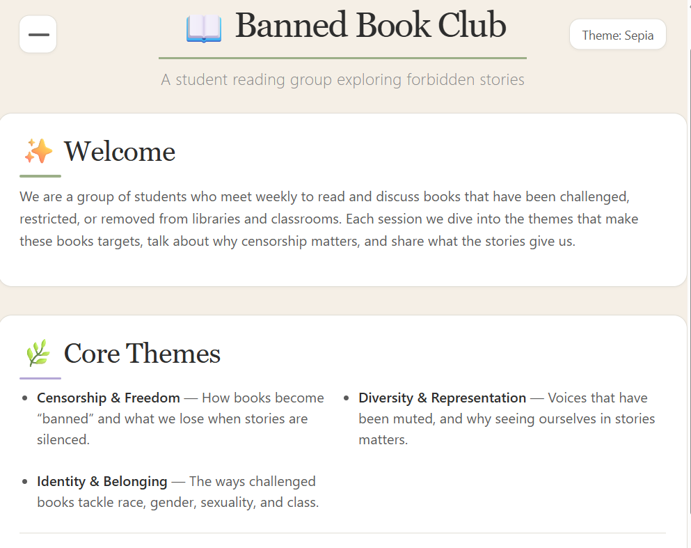

# REFLECTION.md

## Model / Provider Used

- **Primary model**: `opencode/beam-free` (Beam Free) — used for the bulk of the planning, file creation, and iterative design work.
- **Secondary model**: `nvidia/nemotron-3-super-120b-a12b` (Nemotron) — used in a separate session to experiment with UI redesign and coquette aesthetic variations.

## One Useful Prompt

> "Make it more decorative with earth leafy borders, add some pizzazz visual interest."

This prompt was useful because it was specific about the desired visual direction (leafy borders) while leaving room for creative interpretation. It led to the addition of the leaf-emoji garland, leaf icons before headings, and the parchment-like background texture — all via pure CSS, no external assets.

## One Observed Tool Action

The `write` tool was used to create `index.html`, `style.css`, and `script.js` in parallel, and the `edit` tool was used for targeted changes (e.g., updating the theme-switcher button text, adding cute emoji icons to headings). The `question` tool was used at the start to gather audience, content, and look preferences before any code was written.

## Issue / Improvement Checked Before and After a Change

**Issue**: The `script.js` `updateButton` function originally referenced a `nextTheme` variable that was out of scope — it was defined inside the click event handler, but the function itself was defined at the IIFE level. This would have caused a `ReferenceError` at runtime.

**Before**: `button.setAttribute('aria-pressed', nextTheme !== 'light');` inside `updateButton` (broken — `nextTheme` not in scope).

**After**: Changed the function signature to accept `themeKey` as a parameter and used `themeKey !== 'light'` instead. Verified by re-reading the file and confirming all call sites pass the correct argument.

**Additional issue with Nemotron**: During a separate session using the Nemotron model to iterate on the coquette UI, the model did not follow instructions closely — it produced unfavorable UI results (incorrect color choices, layout issues, and styles that did not match the requested aesthetic). The Beam Free model was more reliable for following the specific design constraints (flat design, warm cream palette, dark text, no pink text, Gen-Z Pinterest vibe). This experience highlighted the importance of choosing the right model for design-sensitive tasks.

## How the Interaction Works

The site's primary interaction is a **theme switcher** (light → dark → sepia → light) implemented in `script.js`:

1. On page load, the script checks `localStorage` for a previously saved theme (`book-club-theme`). If none exists, it honors the system `prefers-color-scheme` media query.
2. Clicking the theme-switch button cycles through the three themes, removes the old theme class from `<body>`, adds the new one, and persists the choice to `localStorage`.
3. The button text and `aria-pressed` attribute update to reflect the current theme.
4. CSS variables defined in `:root` and overridden via `body.dark` / `body.sepia` classes drive all color changes, so no JavaScript is needed for styling beyond toggling the class.

A secondary interaction is the **slide-out burger menu**: clicking the burger icon slides a navigation panel in from the left (CSS `left: -300px → 0` transition). It closes via the ✕ button, clicking outside, or pressing Escape. Focus is moved into the menu when opened and returned to the burger when closed.

A third interaction is the **expandable `
` section** ("Join the conversation"), which is keyboard-operable natively (Space/Enter to toggle) and provides meeting information without cluttering the page.

## Screenshot

The screenshot above shows the site served at `http://localhost:8000` with the localhost address bar visible, confirming all content, navigation, and interactions are functional in the browser.